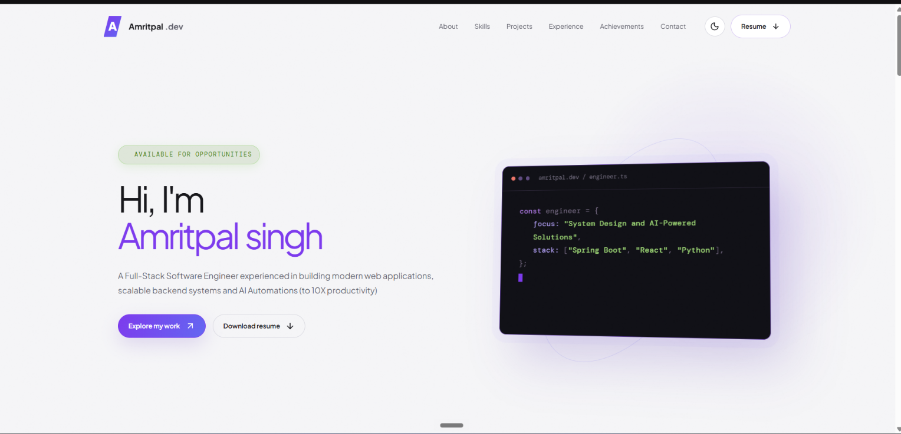

# Amritpal.dev

A responsive personal portfolio for **Amritpal Singh**, a full-stack software engineer. It presents professional experience, technical skills, selected projects, achievements, and contact information in a modern single-page layout.

## Preview



## Features

- Responsive layout for desktop and mobile devices
- Dark and light themes with the selected theme saved locally
- Smooth in-page navigation and scroll animations
- Filterable project cards with detailed project modals
- Skills, experience, achievements, and contact sections
- Resume download link
- Contact form that prepares a message in the user's email application
- Reduced-motion support and accessible controls

## Getting Started

### Prerequisites

- Git
- Node.js
- npm

### Run Locally

1. Fork this repository and clone your fork:

   ```bash
   git clone https://github.com/YOUR-USERNAME/dev-portfolio.git
   cd dev-portfolio
   ```

2. Install the project packages:

   ```bash
   npm install
   ```

3. Start the development server:

   ```bash
   npm run dev
   ```

4. Open the local address printed in the terminal, usually `http://localhost:5173`.

### Available Commands

| Command | Purpose |
| --- | --- |
| `npm run dev` | Starts the local development server |
| `npm run build` | Creates a production build |
| `npm run preview` | Previews the production build locally |
| `npm run lint` | Runs the lint checks |

## Customizing the Portfolio

Most portfolio content is centralized in one data file, so changes do not require editing every component.

### Personal information

Update your name, role, location, contact details, experience, projects, and achievements in:

```text
src/data/profile.js
```

This file exports the following data:

- `profile`: name, biography, links, email, and availability
- `navItems`: section navigation labels
- `skillGroups`: skill categories and skills
- `projects`: project titles, descriptions, tags, architecture, and features
- `experience`: employment history
- `achievements`: certifications and milestones

### Components

The page sections are split into components under `src/components/`:

- `Navbar.jsx` - navigation, mobile menu, and theme toggle
- `HeroSection.jsx` - introduction and primary calls to action
- `About.jsx` - about copy and professional summary
- `Skills.jsx` - skill groups
- `Footer.jsx` - footer and back-to-top control
- `Heading.jsx` - reusable section headings
- `Reveal.jsx` - scroll reveal animation wrapper
- `icons/` - reusable icon components

The main page layout is assembled in `src/App.jsx`.

### Styling

Global styles and the theme variables are maintained in:

```text
src/App.css
src/index.css
```

Update these files to change colors, typography, spacing, card layouts, or theme behavior.

### Resume

Replace `public/Resume.pdf` with your own resume PDF. Keep the filename unchanged unless you also update the resume links in `src/components/Navbar.jsx`, `src/components/HeroSection.jsx`, and `public/`.

### Images

Static public assets, including the favicon and screenshots, belong in `public/`. The hero preview used in this README is `public/hero-seaction.png`.

### Social and Contact Links

Update `profile.github`, `profile.linkedin`, and `profile.email` in `src/data/profile.js`. The contact form uses the email address and opens the user's configured email application.

## Project Structure

```text
.
├── public/
│   ├── Resume.pdf
│   ├── favicon.svg
│   ├── hero-seaction.png
│   └── icons.svg
├── src/
│   ├── assets/
│   ├── components/
│   │   └── icons/
│   ├── data/
│   │   └── profile.js
│   ├── App.css
│   ├── App.jsx
│   ├── index.css
│   └── main.jsx
├── index.html
├── vite.config.js
├── jsconfig.json
├── eslint.config.js
└── package.json
```

## Deployment

Create a production build:

```bash
npm run build
```

Deploy the contents of the generated `dist/` directory to a static hosting provider. Configure the provider to serve `index.html` for the application entry route.

## Contributing

Contributions are welcome. For a focused and easy-to-review contribution:

1. Fork the repository.
2. Create a feature or fix branch:

   ```bash
   git checkout -b feature/your-change
   ```

3. Make and test your changes.
4. Run lint and production build checks:

   ```bash
   npm run lint
   npm run build
   ```

5. Commit the changes and open a pull request with a clear description and screenshots for visual updates.

Please keep profile content factual and preserve responsive and accessible behavior.

## License

This project is licensed under the [MIT License](LICENSE).
